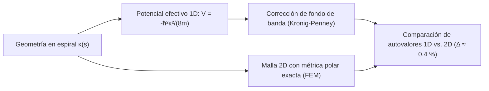

# Trampa de curvatura (v1.5)

---

## 🌀 Descripción General

Simulador numérico de una **trampa cuántica puramente geométrica** para una partícula confinada en una guía de onda en espiral. 

Cuando una partícula cuántica se mueve a lo largo de un canal delgado con curvatura $\kappa(s)$, el desacoplamiento adiabático entre el modo transversal y el longitudinal induce un **potencial geométrico atractivo efectivo** (potencial de da Costa):

$$V_{\text{geom}}(s) = -\frac{\hbar^2 \kappa(s)^2}{8m}$$

La hipótesis explorada es si un máximo local de curvatura permite **atrapar estados ligados sin necesidad de barreras ni paredes de potencial adicionales**.

> [!IMPORTANT]
> **Estado del proyecto:** Hipótesis de ingeniería y modelo numérico de juguete. No es un resultado experimental ni un dispositivo fabricado.

👉 **[Probar el Simulador Interactivo en Vivo](https://mathigza1211.github.io/trampa-de-curvatura/)** *(sin instalación, directo en el navegador).*

---

## 🔬 Arquitectura del Modelo Numérico

### Características Técnicas Implementadas

| Componente | Implementación en el Simulador |
| :--- | :--- |
| **Solver 2D** | Elementos finitos (FEM) sobre coordenadas lógicas empleando la métrica polar exacta. |
| **Corrección de Banda** | Ajuste de fondo de banda tipo **Kronig–Penney** para capturar efectos de modulación periódica/geométrica. |
| **Convergencia 1D–2D** | Validación cruzada entre la aproximación adiabática 1D y el cálculo completo 2D con discrepancia residual documentada de **$\approx 0.4\%$**. |

---

## ⚠️ Límites y Supuestos Declarados

> [!WARNING]
> - **Idealización teórica:** No existe dispositivo fabricado ni medición de laboratorio asociada; las paredes se asumen perfectamente lisas e impenetrables.
> - **Estabilidad numérica en canales estrechos:** La extrapolación del modelo 2D a anchos extremadamente angostos sufre de cancelaciones numéricas (mitigadas parcialmente mediante refinamiento de malla).
> - **Trabajo futuro necesario:** Extender el dominio a espirales de múltiples vueltas e incorporar rugosidad realista en los bordes antes de plantear una fabricación real.

---

## 📄 Archivos del Repositorio

| Archivo | Descripción |
| :--- | :--- |
| [`index.html`](index.html) | Simulador interactivo con controles en tiempo real y gráficas comparativas 1D/2D. |
| [`informe-trampa-curvatura.docx`](informe-trampa-curvatura.docx) | Informe técnico detallado con la derivación de la métrica, formulación FEM y análisis de errores. |

---

## 👤 Autoría

**Mathias Zárate Amenero** — *Lima, Perú*  
Desarrollado junto con **Claude (Anthropic)** *(código e informes elaborados con asistencia de IA; todos los supuestos físicos y numéricos están declarados explícitamente).*

🔗 **Ver más proyectos:** [Portafolio de Simuladores y Prototipos](https://github.com/mathigza1211/simuladores-portafolio)
